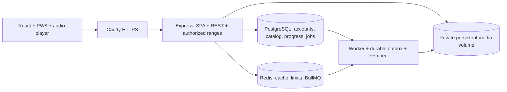

# SoundWave

A full-stack audio listening and creator platform built with React, Express, PostgreSQL, Redis and a background FFmpeg worker. The modular monolith includes authenticated listening, private creator workflows and explicit moderation before publication.

**Status:** V3 is locally verified on `feature/m1-private-playlists`. It has not been pushed or deployed. Remote GitHub Actions has **not run**. The historical [portfolio demo](https://soundwave-codeit-ronit.vercel.app/) runs an older release; its current availability and V3 compatibility were not checked in M6-A.

## What works

- Isolated guest sessions, password authentication and Google Identity Services integration; account profiles and persistent playback preferences.
- Favorites, private named playlists, editable device-local cross-story queue, paginated history and revision-safe progress synchronization across devices.
- Shared persistent audio player, resume, chapter transitions, HTTP byte ranges and bounded PWA chapter downloads with offline seeking.
- Backend discovery and explainable **rule-based** recommendations; listening-event deduplication and analytics rollups.
- Creator activation, ownership-scoped story/chapter drafts, bounded validated PCM WAV uploads and private persistent file storage.
- Durable processing intents/outbox, FFmpeg MP3 conversion, retries, worker-crash recovery and stale-result fencing.
- Exact-revision moderation, rights declarations, publication/unpublication, revocation and operator-provisioned staff roles.
- PostgreSQL transactions, versioned migrations and SQLite compatibility; Redis cache-aside catalog reads/invalidation and distributed route-specific throttling.
- Bounded diagnostics, quarantine/takedown reconciliation and disposable PostgreSQL backup/restore verification.

## Architecture



One deployable application and worker, not microservices. Sessions determine ownership; clients cannot select another account. PostgreSQL records processing intent before dispatch. Cache entries do not grant publication access, and private account data is not placed in shared catalog caches. SQL revision fences protect progress, drafts and publication from stale writes.

## Run locally

Requires Docker/Compose (ARM64 supported). Use a fresh local configuration; preserve any existing `.env` and volumes.

```sh
cp .env.example .env
# Edit .env: set POSTGRES_PASSWORD to a strong URL-safe local password.
docker compose up --build -d
# Open http://localhost:3001
```

Development Compose starts PostgreSQL, Redis, API, worker and local Mailpit. Dependency ports bind loopback. It uses development cookies on local HTTP; this is not the public release profile. Database and private files use named volumes. Stop with `docker compose stop`; do not delete volumes containing wanted data.

For host development, install Node.js 22 and FFmpeg/ffprobe, start PostgreSQL/Redis, set their local URLs in `.env`, then:

```sh
npm ci
npm run db:migrate
npm run dev
# In another terminal:
npm run worker
```

Vite runs at localhost:5173 with its existing API proxy. Production-frontend/PWA checks use `npm run build && npm start` at localhost:3001; service workers are disabled in Vite development. SQLite compatibility is available by explicitly setting `DATABASE_DRIVER=sqlite` and a persistent `DATABASE_PATH`, with PostgreSQL URL unset. Email delivery is disabled by default and recovery returns an explicit error until a real sender is configured.

## Verify and demonstrate

Latest local gate: **487 application tests, 6 CI safety tests, 110 mandatory browser groups and 7 release-stack groups passed**, plus clean installation and production build. Historical larger browser totals used additional optional suites and are not the M6 mandatory count.

[Latest release verification](docs/m6-release-verification.json) records actual counts/commands; [M6 report](docs/M6_RELEASE_CANDIDATE.md) explains changes and limitations. Local checks include the full application/CI-safety suites, mandatory browser gate, clean install, production build and formatting. Real PostgreSQL/Redis/backup tests require disposable services; plain `npm test` without them is not equivalent. Follow [CI setup](docs/CI.md) and use `node scripts/ci/run.mjs install`, `test`, `build`, `format`, `browser` with its guarded environment. The release-specific Docker/TLS check is `node scripts/release-smoke.mjs /private/tmp/release-proof.json`.

Demo: register → activate Creator Studio → create a story/chapter → upload a short PCM WAV → wait for processing → submit with rights declaration → operator-provisioned moderator approves → creator publishes → listener searches, plays, seeks and downloads → revoke and verify new public reads fail. [Operator commands](docs/M6_RELEASE_CANDIDATE.md#initial-deployment-procedure--not-executed-approval-required) do not expose role grants through the public API.

Historical [M3/M4 measurements](docs/M3_M4_HARDENING.md#measured-local-results) use eight local publication cycles, not production traffic. In an injected slow-storage scenario owner-wait p95 changed 55.636→1.215 ms while submit latency increased 60.094→108.051 ms. No production-scale or real-user claims are made.

## Deployment and limits

[The proposed free-tier plan](docs/DEPLOYMENT_FREE_TIER.md) keeps the bundled frontend, sessions and offline audio on one HTTPS origin. `compose.release.yaml` adds private dependency networks, separate migration/runtime roles, resource caps, persistent volumes and a quarantine default. Public capacity, DNS, ACME, current-host Google configuration, remote CI and cloud pricing still require approval and verification. No paid services or public resources were created.

A single VM is not highly available. Global disk admission, automated offsite encrypted backups, external alerts, full OpenAPI coverage and cross-browser certification remain incomplete. Offline/buffered copies cannot reliably be recalled. Email delivery is at least once; recommendation ranking is deterministic, not machine learning. See [architecture](docs/ARCHITECTURE.md), [operations](docs/OPERATIONS.md), [roadmap](docs/SOUNDWAVE_V3_ROADMAP.md) and [release blockers](docs/M6_RELEASE_CANDIDATE.md#blockers-and-decisions).

## Content

The twelve bundled 32–37-second PCM WAV chapters were generated from `server/content/catalog.js` using the macOS Samantha voice; covers use original CSS/vector compositions and Lucide icons (ISC). Optional LibriVox imports retain source attribution and stream Internet Archive recordings; public-domain status is qualified for the USA, not promised globally. See [provider policy](docs/LIBRIVOX_INTEGRATION.md). Creator uploads require a rights declaration. Normal setup does not regenerate audio or call a paid content API.
