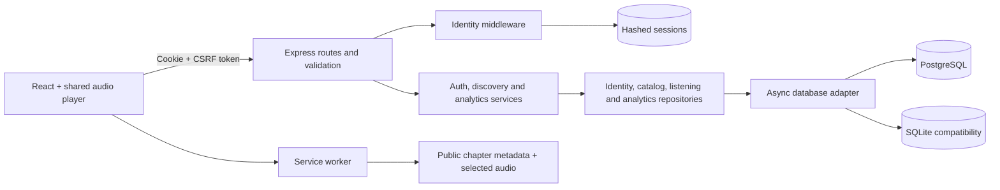

# SoundWave Phase 1 architecture

Phase 1 adds PostgreSQL, authentication and multi-user isolation to the existing modular monolith. It preserves React/Vite, Express, streaming and explicit offline downloads. Redis, workers, uploads, transcoding and CDN delivery are not implemented.

## Request flow and ownership

The cookie determines identity. Each private operation uses `req.user.id` resolved from the session table. No request body, query string or forwarding header selects the owner. Public catalog and media reads work without a session; favorite flags and chapter positions reflect only the current identity, or neutral values when anonymous. Library, progress and analytics require an authenticated registered or guest session.

`X-Session-User` is a stale-tab guard, not an authorization credential: it can only reject a request whose asserted account differs from the server-resolved session. CSRF tokens also bind queued player writes to the session that created them. A player mounted for an old account cannot obtain a new session's token through the mutable global client scope. Account changes remount player/library state. BroadcastChannel tells other tabs to reload, with a sender identifier preventing self-reload.

Legacy contract tests inject identity and CSRF middleware in `server/test/helpers.js` to preserve the original endpoint assertions. This is constructor-level test dependency injection, not a runtime environment switch, HTTP header or public authentication bypass. Separate auth tests and browser checks use the real middleware on both adapters.

## Authentication design

- Registration validates an email, a name of 1–80 characters, and a password of at least 12 characters and at most 256 UTF-8 bytes. Emails are normalized to lowercase and uniquely constrained.
- Passwords use Node's asynchronous **scrypt**, `N=131072`, `r=8`, `p=1`, a random 128-bit salt and a 64-byte derived key. Cost parameters are fixed and checked on verification; comparisons use `timingSafeEqual`. Unknown users still perform a derivation. At most two derivations run per Node process to bound memory use; excess work returns 503. This is a reputable password-hashing alternative, not Argon2id.
- Session tokens contain 256 random bits. Only SHA-256 token hashes are stored in the database; passwords, raw session cookies and request bodies are not logged by request logging.
- Production cookies use `__Host-soundwave`, `Secure`, `HttpOnly`, `SameSite=Lax`, `Path=/`, no Domain, and a bounded expiry. Local HTTP uses `soundwave-session` without Secure. Production startup requires an exact HTTPS `APP_ORIGIN`.
- Expiration is checked against the database on every session lookup. Registered sessions default to seven days, guests to one day, and pre-login anonymous sessions to ten minutes. There is no sliding renewal. Login, registration and guest creation rotate the session and CSRF token. Logout deletes the database row and expires the cookie.
- `/api/auth/session` issues a pre-login session and exposes only its CSRF token, sanitized profile, expiry and demo availability. Every unsafe request, including registration/login/logout, needs the corresponding `X-CSRF-Token`; untrusted Origin and cross-site Fetch Metadata values are rejected. Production trusts only `APP_ORIGIN`. Local development also permits the configured dev frontend defaults and the server's actual same-origin URL.
- General API limits remain 300/IP/minute/process, with audio exempt. Authentication writes have a separate 15/IP/15-minute/process limit. There is no distributed limiter yet, no trusted-proxy inference from arbitrary forwarding headers, and no account-level lockout or bot challenge.

These choices follow [OWASP password storage](https://cheatsheetseries.owasp.org/cheatsheets/Password_Storage_Cheat_Sheet.html), [session management](https://cheatsheetseries.owasp.org/cheatsheets/Session_Management_Cheat_Sheet.html) and [CSRF](https://cheatsheetseries.owasp.org/cheatsheets/Cross-Site_Request_Forgery_Prevention_Cheat_Sheet.html) guidance. They have regression coverage, not a penetration-test or production-security certification.

## Demo accounts and preservation

The frontend automatically exchanges an anonymous CSRF session for an isolated guest when demo mode is enabled. Guests can use the same player, library, recommendations and analytics, with an independently generated owner UUID. `DEMO_MODE=false` disables this exchange; it does not grant a fallback identity.

Registering while a guest upgrades that guest row transactionally, retaining its ID and owned records. Logging into an existing account switches identities and does not merge unrelated guest data. The previous shared `demo-user` is retained as an unclaimable `legacy` identity: neither authentication nor the demo endpoint can sign into it. Preserving legacy data does not make it every visitor's personal history.

## Database and transactions

PostgreSQL is selected by `DATABASE_URL`. `pg` supplies a bounded pool with connection, statement and lock timeouts. Its transactions pin one checked-out connection using AsyncLocalStorage; COMMIT/ROLLBACK always releases that connection. No transaction uses unrelated pool queries. See [node-postgres transactions](https://node-postgres.com/features/transactions).

The small adapter binds application-owned `?` and `@name` placeholders to PostgreSQL `$n` parameters, skipping quoted literals; values are transmitted separately. Sort expressions come from a fixed allowlist. Dialect-specific current-time, UTC-date and event-order expressions live in the adapter. This is a bounded internal query interface, not an arbitrary SQL translator or ORM. Prepared SQL/repositories remain directly readable.

SQLite remains available for development and existing data. Its async compatibility adapter serializes operations and holds `BEGIN IMMEDIATE` through async transactions, so requests cannot interleave inside another request's write transaction. The original synchronous SQLite handle remains usable for test fixtures and old local tooling.

| Relation                  | Identity, constraints and indexing                                                                                                                                                         |
| ------------------------- | ------------------------------------------------------------------------------------------------------------------------------------------------------------------------------------------ |
| `users`                   | Text PK; unique lowercase email; registered/guest/legacy kind; registered accounts require a password hash and email                                                                       |
| `sessions`                | Hashed-token PK; nullable user FK for pre-login sessions; user and expiry indexes; CSRF token and expiry                                                                                   |
| `stories`                 | Catalog PK, required metadata; PostgreSQL genre index                                                                                                                                      |
| `chapters`                | Story FK; unique story/chapter number and story/id; positive duration                                                                                                                      |
| `favorites`               | Composite owner/story PK and FKs; owner/recency index                                                                                                                                      |
| `listening_progress`      | Composite owner/chapter PK and FKs; nonnegative finite position; completion constraint; recency index                                                                                      |
| `progress_write_versions` | Composite owner/chapter/client PK; positive safe integer sequence                                                                                                                          |
| `listening_events`        | Composite owner/event PK; owner, story and chapter FKs; story/chapter relationship FK; type/duration/JSON constraints; user/time and user/story indexes; monotonic event-order tie-breaker |
| `schema_migrations`       | Version PK, SHA-256 checksum and application time                                                                                                                                          |

Favorite additions and their events commit together. Progress changes, ordering versions and completion events commit together. PostgreSQL progress transactions use an owner/chapter advisory lock so concurrent first completions create one transition event. A conditional version upsert ignores stale same-client snapshots. Different clients remain last-arriving writers; this is not general conflict resolution.

Event idempotency is scoped to `(user_id,event_id)`. Identical retries do not add time; conflicting payloads return 409, including a post-insert comparison covering simultaneous conflicting requests. The same event UUID from two owners never exposes or suppresses another owner's event.

Migrations are ordered SQL files, checksum-checked and transactional. PostgreSQL migration runners serialize through a database advisory lock. SQLite adds auth and ownership guards without erasing existing rows; it retains the pre-migration event table as `legacy_listening_events_v0` while copying rows into the new owner-keyed event table. This archival table intentionally consumes disk until an operator reviews retention. No automatic down migrations or table-dropping reset command is provided.

The explicit SQLite importer reads one source snapshot in read-only mode and inserts into PostgreSQL in one transaction. It preserves owner IDs and timestamps, skips existing target keys, does not copy sessions, and never writes the source file. Existing conflicting target data is not overwritten. Review counts and reconcile conflicts before treating an import as a complete cutover. Catalog seeding remains idempotent and preserves listener rows.

## Browser storage boundary

Session profiles, CSRF responses, libraries, progress and analytics are not put into Cache Storage. API responses use private/no-store and Vary: Cookie. The new worker drops the old general JSON cache; it performs network reads and only falls back to explicitly stored public metadata.

Selected downloads retain public catalog metadata with favorite/progress/completion/identity fields removed or reset. Audio is public catalog content, so downloads are intentionally device-wide across account changes. They are not private licensed media. Server-side authorization would not protect content already stored on a device; private entitlement-based downloads are outside Phase 1.

The shell, downloads, range seeking, cache removal and quota failure behavior remain covered. There is no offline auth or private-data sync queue. An offline reload permits downloaded playback with neutral metadata, not a restored authenticated session.

## Deployment and next phases

Use a persistent PostgreSQL service, verified database TLS where needed, HTTPS at the app origin, backups and a trusted reverse proxy. Size the connection budget as instances × pool max; no benchmark supports a scaling claim yet. Runtime migrations are convenient here; larger migrations should become a controlled release step with an appropriately privileged migration role and a restricted app role.

Compose supplies PostgreSQL and a non-root Node app with a named database volume. Startup retries only transient database-connectivity failures with bounded backoff; schema/checksum/configuration failures are not retried. PostgreSQL restarts unless stopped; the app has an on-failure policy capped at five restarts. A simultaneous container restart exposed and verified the fix for a database-readiness race. Its default localhost HTTP mode explicitly uses development cookies. For public hosting set `APP_NODE_ENV=production`, set an HTTPS `APP_ORIGIN`, and terminate TLS before exposing the app. Do not run a public deployment in development mode.

The existing Vercel live link was not redeployed for Phase 1. Its old shared demo remains available. A Phase 1 Vercel deployment requires `DATABASE_URL`, HTTPS `APP_ORIGIN` and a managed PostgreSQL connection budget; SQL migrations/audio are included in the function bundle. Ephemeral SQLite is rejected in production unless an operator explicitly opts into the limited portfolio fallback. No new public PostgreSQL deployment has been verified.

Remaining operational work includes session/guest retention and expiry cleanup, email verification, password recovery/change, MFA, account deletion, security headers/CSP review, distributed throttling, deployment secrets, backups and restore drills, database role separation, telemetry, load tests and cross-browser/device tests.

**Redis next:** first add bounded distributed authentication/API limits and explicit proxy trust. Only then cache public catalog/search with versioned keys and TTLs. Personalized caches must include owner IDs and reliable invalidation; do not place private responses under shared keys. PostgreSQL remains the source of truth. Decide from measured latency whether session caching is useful, and preserve immediate revocation/expiry semantics.

**Jobs next:** add a PostgreSQL transactional outbox for maintenance/analytics tasks, then a worker with idempotency keys, bounded retries, backoff, dead-letter visibility and graceful shutdown. Redis/BullMQ is an option if a queue service is justified. Start with expired-session/guest cleanup and analytics rollups; do not move synchronous progress acknowledgements into an unreliable fire-and-forget queue. Neither Redis nor workers are implemented in this phase.
