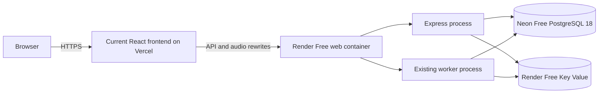

# Verified free public demo

Verified on **6 November 2026**. This report supersedes the older reports' public-deployment status, not their performance/security qualifications.

**Newer catalog release:** Runtime `188539f` subsequently added ten LibriVox books / 212 external chapters and was deployed to both hosts. See [LIBRIVOX_INTEGRATION.md](LIBRIVOX_INTEGRATION.md) for the current 133-test checkpoint, public release IDs and real MP3/PWA checks. The first free rollout below is retained as historical verification.

## Live addresses and release

- Frontend/resume URL: **https://soundwave-codeit-ronit.vercel.app/**
- Previously submitted URL: **https://zippy-nitrogen-wd3scr3.tmp.now/** — anonymous HTTP and Chrome checks confirm it redirects to the same current frontend.
- API/media origin behind Vercel's same-origin rewrites: **https://soundwave-demo.onrender.com**

Backend release: `5332eb9`, built from GitHub on Render with the existing Dockerfile. Frontend/proxy release: `545b1a4`, built remotely on Vercel with Node 22 and staged before promotion. The runtime source is identical between these commits; the latter changes only Vercel routing and deployment exclusions. Subsequent documentation/test commits do not change application runtime behavior.

Render deployed `dep-dbmtfdm7bikc73bva9ug` successfully. Vercel deployment `dpl_7EnTytFwF5Z1fxZq6b7w3RFgFpF2` was staged, checked, then promoted. The previous Vercel deployment was retained for rollback. No paid services were provisioned.

## Actual hosted architecture

- PostgreSQL connection was verified over TLS and reported **18.6**. Six versioned migrations, six catalog stories and **12 actual `chapter_media` results** were present.
- API and worker use the same private Redis-compatible store, prefix and PostgreSQL database. Cache-aside and media jobs are enabled. `/api/ready` returns database `ok`, Redis `ready`.
- Render's API and worker startup messages and completed database media results were checked. The demo supervisor terminates both children when one fails and forwards graceful termination. Normal local Compose still uses separate API/worker containers.
- Vercel serves static frontend assets and proxies `/api/*` and `/audio/*` to Render. The old ephemeral serverless adapter is excluded with `.vercelignore`. No database/Redis secret is present in frontend environment variables or committed configuration.
- Production `APP_ORIGIN` is the canonical Vercel URL. Public-browser checks confirmed Secure, HTTP-only `__Host-soundwave` session cookies and working CSRF-protected writes.

## Executed checks

| Check                                                                                                              | Actual result                                                                                                                                                                                                              |
| ------------------------------------------------------------------------------------------------------------------ | -------------------------------------------------------------------------------------------------------------------------------------------------------------------------------------------------------------------------- |
| `TEST_DATABASE_URL=... TEST_REDIS_URL=... npm run test:demo`                                                       | **5 PASS**: real fresh PostgreSQL migrations, guest/favorite/range flow, worker SIGKILL stops sibling API, restart retains state, graceful stop, invalid configuration fails                                               |
| `docker build --target api -t soundwave:free-demo .`                                                               | **PASS**; clean image dependency install and frontend production build; 1,700 Vite modules                                                                                                                                 |
| Production-mode container with `node server/scripts/demo.js`                                                       | **PASS**; HTTP readiness, PostgreSQL health, completed metadata, worker heartbeat and Docker health                                                                                                                        |
| Published Render JSON schema and `render blueprints validate ./render.yaml`                                        | **PASS**, `valid: true`, free web/Key Value resources                                                                                                                                                                      |
| Direct Render HTTPS checks                                                                                         | **PASS**: PostgreSQL health, Redis readiness, title search, completed media, 100-byte 206, invalid-range 416 and body-free HEAD                                                                                            |
| Staged Vercel HTTPS checks                                                                                         | **PASS**: homepage, `/stories/1` SPA route, PostgreSQL health, Redis readiness and metadata through external rewrites                                                                                                      |
| `node scripts/public-smoke.mjs https://soundwave-codeit-ronit.vercel.app`                                          | Existing test: **5 PASS**; submitted URL redirect, decoded audio, service worker, complete download, offline reload/play/range and removal                                                                                 |
| `node scripts/public-backend-smoke.mjs https://soundwave-codeit-ronit.vercel.app`                                  | **9 PASS**; hosted services/ranges/search, current account UI, secure cookies, refresh resume/favorites, registration, logout/login, independent visitors, offline flow, CSRF rejection and no uncaught browser exceptions |
| `render restart srv-dbmtfde7bikc73bva8rg --confirm` followed by authenticated checks using the same private cookie | **4 PASS**: original session remains valid; favorite/exact progress retained; analytics totals and asynchronous rollup retained; completed media retained                                                                  |
| Both existing resume URLs checked anonymously after promotion                                                      | **PASS**; canonical API reports `database: postgres`; submitted URL reaches canonical frontend                                                                                                                             |

The public backend test creates an explicit `public-smoke-<UUID>@example.com` test account. The restart check created a separate test guest and a two-second fixture interval. These are verification fixtures, not real users or organic listening metrics; their identified records were cleaned up after checks.

An initial extended browser run timed out once waiting for immediate refresh resume. The saved PostgreSQL position remained correct. A diagnostic browser run, an exact-sequence reproduction and the complete rerun subsequently restored the paused position and passed. No unverified runtime fix is claimed for that transient wait; public cold-start/network timing remains a limitation.

The earlier implementation checkpoint's **122 automated tests**, local failure-recovery scenarios and HTTP load measurements are recorded separately in [RESUME_CLAIM_VERIFICATION.md](RESUME_CLAIM_VERIFICATION.md). That entire suite was not rerun during this deployment-only phase. No new public performance or production-capacity benchmark was performed.

## Free-tier limits and remaining work

- Render Free sleeps after 15 idle minutes; API and worker both sleep. The first API request can take roughly a minute to wake the service. No fake keep-alive service is configured. This is not continuously available background processing.
- Free Key Value does **not** persist Redis contents across restarts. Cache and limits refill; missing catalog media jobs can be scheduled again using persistent PostgreSQL results and bundled audio. Arbitrary queue/failed-job state is not durable on this plan. The persistent-AOF behavior tested in local Compose must not be attributed to free hosted Redis.
- Neon Free has storage/compute quotas. Users, sessions, favorites, progress, analytics/outbox and media results are in PostgreSQL. The old shared user's ephemeral Vercel database was not imported into individual accounts.
- External email delivery is disabled. Registration/login/demo listening work; recovery/resend explicitly reports unavailable. No verified internet SMTP service was provisioned.
- Proxy trust remains conservative; unverified forwarding headers are ignored. Per-IP limits can group visitors behind hosting proxies. Dedicated proxy-chain/IP attribution, larger mixed-traffic tests and abuse monitoring remain operational work.
- Long-running durability, HA/failover, offsite backup/DR, external mail deliverability, sustained traffic and cross-browser/mobile hardware were not established. Free-tier quotas and provider account status can affect availability.

Free services were selected explicitly using provider free plans. See [the reproducible deployment recipe](FREE_DEMO_DEPLOYMENT.md) and provider limits: [Render Free](https://render.com/docs/free), [Neon Free](https://neon.com/pricing).

## Future updates

Public deployment is a reviewed release step, not an assertion that every GitHub push deploys automatically. The Render service currently has automatic deployment disabled. Deploy and verify its chosen commit first, then stage the Vercel frontend with `--prod --skip-domain`, check it and promote. Keep the `tmp.now` claimed deployment and redirect intact. Update this report when a new runtime release is publicly verified.
